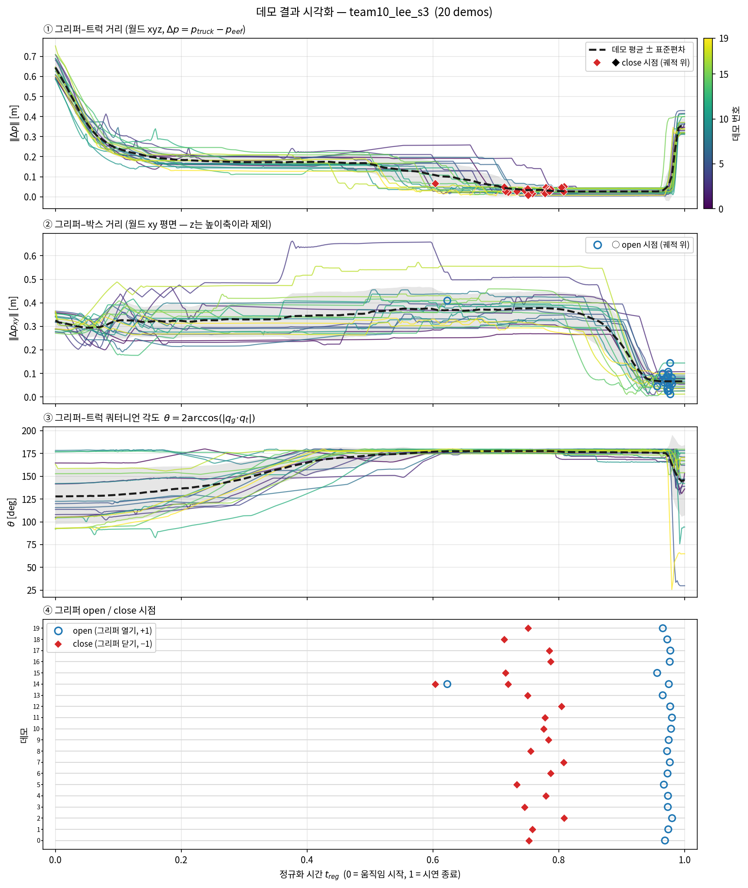
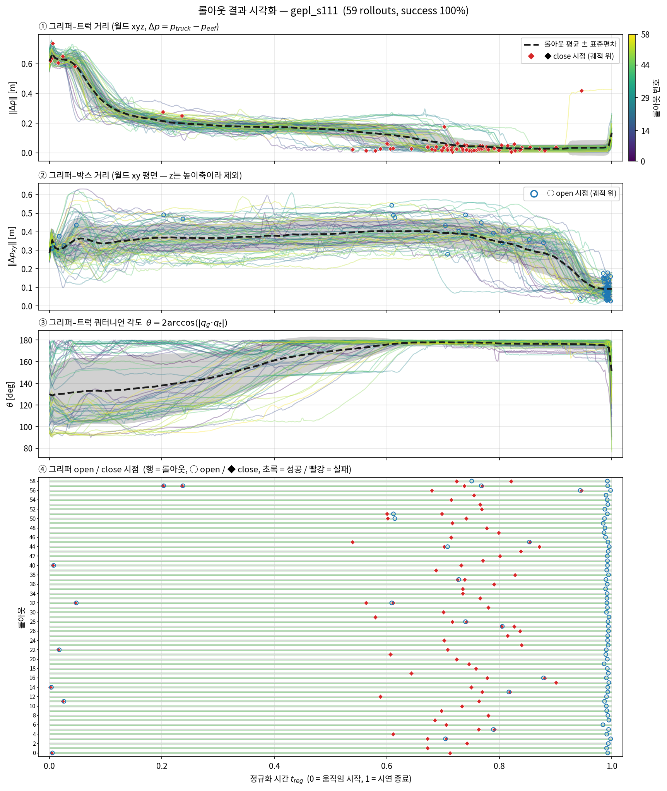
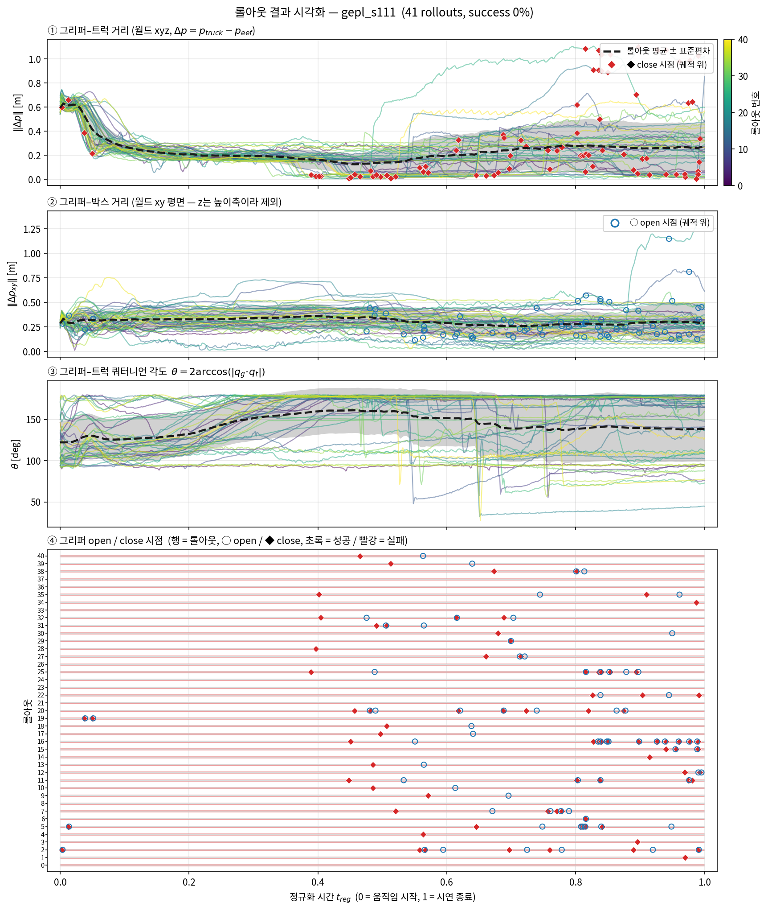

모방학습 과제 팔로우업 보고서
박현우
    
1. **(최초 실행 시) git clone 및 셋팅 과정**
    
    ```jsx
    cd ~/
    git clone https://github.com/LHE9898/RoboticsSimulation_2026 ~/IsaacLab_RS

    cd ~/IsaacLab_RS
    conda install -c conda-forge git-lfs
    git lfs install
    git lfs pull
    ```

2. **IsaacLab 폴더 진입 & conda 환경 활성화**
    
    ```jsx
    cd ~/IsaacLab_RS
    conda activate lerobot-arena
    ```
    폴더명 및 디렉토리는 100% 일치해야 함 (conda lerobot-arena가 디렉토리에 종속되어 있음!)

3. **데모 데이터 분포 검증**
    
    ```jsx
    ./isaaclab.sh -p summarize_demos.py
    ```


### 모방학습 시범 원본부터 전처리 데이터
| 단계 | 파일 |
|---|---|
| 사람 시범 기록 (`record_demos.py`) | `datasets/team10_lee_s3.hdf5` (20개) |
| Annotation | `datasets/team10_lee_s3_annotated.hdf5` |
| Mimic 생성 | `datasets/team10_lee_s3_mimic_500.hdf5` (성공 500개) |
| 학습 데이터 | `datasets/mimic_500_rel.hdf5` (위 파일 + 새 관측 키) |
사람 시범 기록: 유저가 생성한 20개의 데이터

### 학습 결과 가중치 파일
| run | 체크포인트 (`logs/robomimic/<task>/…/models/model_epoch_2000.pth`) | rollout 기록 | 영상 |
|---|---|---|---|
| base_s101 | `bc_rnn_low_dim_agibot_toy2box_seed101/20261030112049` | `outputs/rollouts/base_s101/` | 없음 |
| base_s111 | `bc_rnn_low_dim_agibot_toy2box_seed111/20261030115923` | `outputs/rollouts/base_s111/` | 없음 |
| gepl_s101 | `bc_rnn_low_dim_agibot_toy2box_ge_ee_place_seed101/20261030163015` | `outputs/rollouts/gepl_s101/` | `videos/rel/gepl_s101/` |
| gepl_s111 | `bc_rnn_low_dim_agibot_toy2box_ge_ee_place_seed111/20261030170827` | `outputs/rollouts/gepl_s111/` | `videos/rel/gepl_s111/` |

### analysis_plots_datasets.py을 통한 학습 데이터 분석
가설: 상대 위치 및 회전 데이터 (eef-truck xyz, box-xy, eef-truck quat)를 보고 성공 혹은 실패 시나리오의 특성을 예측할 수 있을 것이다. 또한 성공 사례에서는 뚜렷한 특징이 있을 것이다.

질문: 박스 밖 놓기 작업은 world frame 상 수평 이동인데, 신경망이 이 수평 이동을 학습할 수 있을 것인가?

----

그래프를 통한 수평 이동의 정의 : world frame 상 xy 이동하여 eef-box 좌표 오차가 0.2 이하가 되는 것이다.

학습 데이터가 이를 잘 반영했는지 평가해보았다.



성공한 데이터들은 eef-box 좌표 오차가 0.2로 모두 수렴하였다.
그러나 실패한 데이터들은 수렴하지 않았다.

gepl 중에서 성공한 데이터들은 모두 일관성이 있으나, 실패한 데이터들은 성공한 데이터의 궤적을 전혀
따라가지 않았다 (데이터가 발산했다)

성공이나 실패 공통적으로, 그리퍼-트럭 데이터 (1번 plot)은 초기 시각(0.0~0.1초)에서 일관성이 존재하였다.

----

(3)번 plot 분석 계속 + mimic_500_rel 데이터 분석
/home/phw0402/IsaacLab_RS/outputs/analysis_plots/mimic_500_rel_overview.png
mimic하여 500개로 늘린 데이터에서는 성공했는데 불구하고 좌표오차 0.2로 수렴하지 않는 이상치들이 존재하며, 또한 그리퍼 동작 실수 (학습, 14번 데이터) 가 그대로 데이터에 반영되었다.

----

mimic_500_rel 데이터 분석을 계속 하자면

그러나 orientation의 수렴성은 매우 컸다. 초기 시점에서 orientation 차는 매우 불규칙하고 분산된 특성을 보이다가. 잡기 구간에서 orientation은 170~180 deg 내로 치밀하게 수렴된다. 이는 xyz 오차가 분산을 유지하면서 특정 곡선을 따라 이동하는데 반해, orientation은 bottleneck 특성을 보였다. 이 bottleneck 구간까지 이동-잡기 구간이라고 볼 수 있으므로, 이 bottleneck 특성을 시연 데이터에서 보일 수 있도록 데이터를 첨가하면 학습 결과가 더 개선되지 않을까?

또한, 쿼터니언 orientation 차는 그저 3D의 회전 변수를 도표로 스칼라화 하기 위해 도입한 식이라, 다봉성이 있을 것으로 예상되었는데, 다행히도 우리가 수집한 데이터에는 그런 다봉성이 존재하지 않았다.

----

따라서, orientation norm을 170~180으로 수렴시키도록 유도하기 위해, orientation norm을 학습 input에 추가하는 것을 건의한다. (orientation또한 좌표계에 속하므로,  상대 좌표를 학습 변수로 추가한다는 기존 가설에서도 벗어나지 않는다.)

