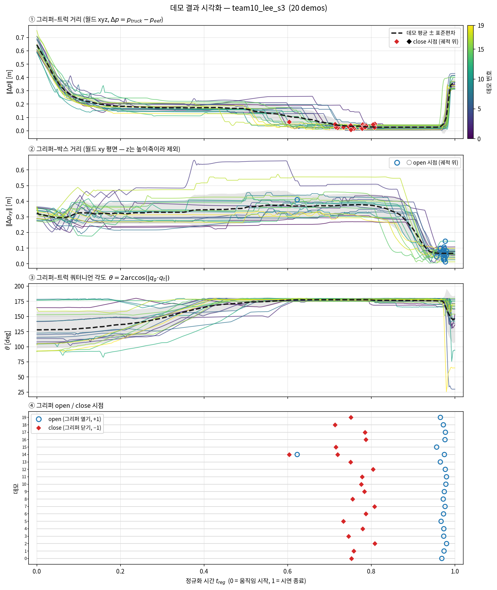
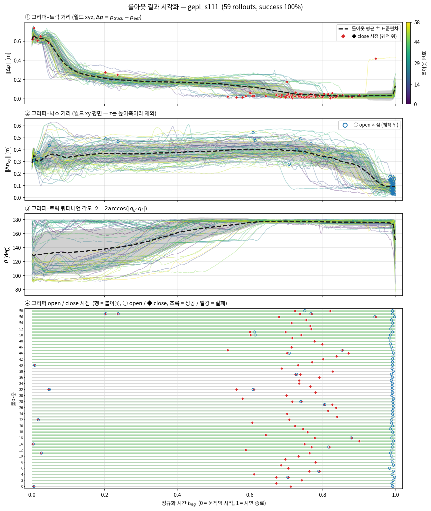
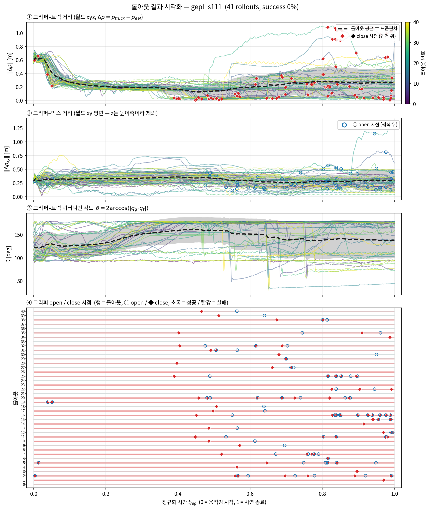

모방학습 과제 팔로우업 보고서
박현우
    
1. **(최초 실행 시) git clone 및 셋팅 과정**
    
    ```shell
    cd ~/
    git clone https://github.com/LHE9898/RoboticsSimulation_2026 ~/IsaacLab_RS

    cd ~/IsaacLab_RS
    conda install -c conda-forge git-lfs
    git lfs install
    git lfs pull
    ```

2. **IsaacLab 폴더 진입 & conda 환경 활성화**
    
    ```shell
    cd ~/IsaacLab_RS
    conda activate lerobot-arena
    ```
    폴더명 및 디렉토리는 100% 일치해야 함 (conda lerobot-arena가 디렉토리에 종속되어 있음!)

3. **데모 데이터 분포 검증**
    
    ```shell
    ./isaaclab.sh -p summarize_demos.py
    ```


### 모방학습 시범 원본부터 전처리 데이터
| 단계 | 파일 |
|---|---|
| 사람 시범 기록 (`record_demos.py`) | `datasets/team10_lee_s3.hdf5` (20개) |
| Annotation | `datasets/team10_lee_s3_annotated.hdf5` |
| Mimic 생성 | `datasets/team10_lee_s3_mimic_500.hdf5` (성공 500개) |
| 학습 데이터 | `datasets/mimic_500_rel.hdf5` (위 파일 + 새 관측 키) |
사람 시범 기록: 유저가 생성한 20개의 데이터

### 학습 결과 가중치 파일
| run | 체크포인트 (`logs/robomimic/<task>/…/models/model_epoch_2000.pth`) | rollout 기록 | 영상 |
|---|---|---|---|
| base_s101 | `bc_rnn_low_dim_agibot_toy2box_seed101/20261030112049` | `outputs/rollouts/base_s101/` | 없음 |
| base_s111 | `bc_rnn_low_dim_agibot_toy2box_seed111/20261030115923` | `outputs/rollouts/base_s111/` | 없음 |
| gepl_s101 | `bc_rnn_low_dim_agibot_toy2box_ge_ee_place_seed101/20261030163015` | `outputs/rollouts/gepl_s101/` | `videos/rel/gepl_s101/` |
| gepl_s111 | `bc_rnn_low_dim_agibot_toy2box_ge_ee_place_seed111/20261030170827` | `outputs/rollouts/gepl_s111/` | `videos/rel/gepl_s111/` |

### analysis_plots_datasets.py을 통한 학습 데이터 분석
가설: 상대 위치 및 회전 데이터 (eef-truck xyz, box-xy, eef-truck quat)를 시계열로 보면 성공 혹은 실패 시나리오의 특성을 예측할 수 있을 것이다.

질문 1: 박스 밖 놓기 작업은 world frame 상 수평 이동인데, 신경망이 이 수평 이동을 학습할 수 있을 것인가?

----

그래프를 통한 수평 이동의 정의 : world frame 상 xy 이동하여 eef-box 좌표 오차가 0.2 이하가 되는 것이다.

학습 데이터가 이를 잘 반영했는지 평가해보았다.



성공한 데이터들은 eef-box 좌표 오차가 0.2로 모두 수렴하였다.
그러나 실패한 데이터들은 수렴하지 않았다.

gepl 중에서 성공한 데이터들은 모두 일관성이 있으나, 실패한 데이터들은 성공한 데이터의 궤적을 전혀
따라가지 않았다 (데이터가 발산했다)

성공이나 실패 공통적으로, 그리퍼-트럭 데이터 (1번 plot)은 초기 시각(0.0~0.1초)에서 일관성이 존재하였다.

----

(3)번 plot 분석 계속 + mimic_500_rel 데이터 분석
/home/phw0402/IsaacLab_RS/outputs/analysis_plots/mimic_500_rel_overview.png
mimic하여 500개로 늘린 데이터에서는 성공했는데 불구하고 좌표오차 0.2로 수렴하지 않는 이상치들이 존재하며, 또한 그리퍼 동작 실수 (학습, 14번 데이터) 가 그대로 데이터에 반영되었다.

----

mimic_500_rel 데이터 분석을 계속 하자면

그러나 orientation의 수렴성은 매우 컸다. 초기 시점에서 orientation 차는 매우 불규칙하고 분산된 특성을 보이다가. 잡기 구간에서 orientation은 170~180 deg 내로 치밀하게 수렴된다. 이는 xyz 오차가 분산을 유지하면서 특정 곡선을 따라 이동하는데 반해, orientation은 bottleneck 특성을 보였다.

또한, 쿼터니언 orientation 차는 그저 3D의 회전 변수를 도표로 스칼라화 하기 위해 도입한 식이라, 다봉성이 있을 것으로 예상되었는데, 다행히도 우리가 수집한 데이터에는 그런 다봉성이 존재하지 않았다. 따라서 학습에 방해되는 요소 (다봉성) 없음.

질문 2: 이 bottleneck 특성을 시연 데이터에서 보일 수 있도록 데이터를 첨가하면 학습 결과가 더 개선되지 않을까?

orientation norm을 170~180으로 수렴시키도록 유도하기 위해, orientation norm을 학습 input에 추가하는 것을 건의한다. (orientation또한 좌표계에 속하므로,  상대 좌표를 학습 변수로 추가한다는 기존 가설에서도 벗어나지 않는다.)

----
### grasp_err_angle feature 추가를 통한 학습 데이터 개선률 (구간 별, 전체 별) 분석

```shell
conda activate lerobot-arena && cd ~/IsaacLab_RS
TASK=Isaac-Place-Toy2Box-Agibot-Right-Arm-RmpFlow-v0

bash tools_c/run_c_pipeline.sh convert_rel2

# 학습 (seed 101, 111). 실험2는 --algo bc_ge_ee_place_geangle
for SEED in 101 111; do
./isaaclab.sh -p scripts/imitation_learning/robomimic/train.py --task $TASK \
    --algo bc_ge_ee_place_geangle --dataset ./datasets/mimic_500_rel2.hdf5 --seed $SEED
done

./isaaclab.sh -p tools_c/play_record.py --task $TASK --checkpoint logs/robomimic/Isaac-Place-Toy2Box-Agibot-Right-Arm-RmpFlow-v0/bc_rnn_low_dim_agibot_toy2box_ge_ee_place_geangle_seed101/20261101154433/models/model_epoch_2000.pth --num_rollouts 100 --horizon 800 --seed 42 --headless --out_dir ./outputs/rollouts/gepl2_s101 --video --video_length 800 --video_folder ./videos/rel/gepl2_s101

./isaaclab.sh -p tools_c/play_record.py --task $TASK --checkpoint logs/robomimic/Isaac-Place-Toy2Box-Agibot-Right-Arm-RmpFlow-v0/bc_rnn_low_dim_agibot_toy2box_ge_ee_place_geangle_seed111/20261101162203/models/model_epoch_2000.pth --num_rollouts 100 --horizon 800 --seed 42 --headless --out_dir ./outputs/rollouts/gepl2_s111 --video --video_length 800 --video_folder ./videos/rel/gepl2_s111
```

----

seed 101 rollout video 관찰 결과

videos/rel/gepl2_s101/rollout-episode-3.mp4

박스를 건든 후 로봇 동작이 이상해짐

videos/rel/gepl2_s101/rollout-episode-9.mp4

eef가 왼쪽 손에 닿아서 트럭이 충돌 후 로봇 동작이 이상해짐

혹시 박스나 왼쪽 손과의 충돌이 실패를 유발하나?
왼쪽 손과의 충돌로 grab 실패는 이동 후 큰 리스크지만, 박스 건들인 것은 어떻게든 회복 시킬 수 있다. 또한 어떤 트럭-박스 배치는 박스를 옮겨야 성공할 수 있기도 하다. 학습 데이터의 부족이 있는 것으로 보고, eef와 박스와의 충돌 후 회복 상황을 재현한 데이터를 쌓는 것이 좋을 것이라 판단한다.

----

### gepl2 (`bc_ge_ee_place_geangle`) vs gepl (`bc_ge_ee_place`) — rollout 통계 비교

```bash
python tools_c/analyze_rollouts.py --baseline outputs/rollouts/gepl_s101 outputs/rollouts/gepl_s111 \
  --exp outputs/rollouts/gepl2_s101 outputs/rollouts/gepl2_s111
```

**성공률과 실패 단계** (run당 n = 100)

| run | 성공 | 접근 실패 | 파지 실패 | 운반 실패 | 배치 실패 | 박스 밖 놓기 |
|---|---|---|---|---|---|---|
| gepl_s101 | 0.50 | 0.29 | 0.02 | 0.16 | 0.03 | 0.18 |
| gepl_s111 | 0.59 | 0.20 | 0.03 | 0.17 | 0.01 | 0.19 |
| gepl2_s101 | 0.48 | 0.22 | 0.07 | 0.20 | 0.03 | 0.16 |
| gepl2_s111 | 0.58 | 0.21 | 0.08 | 0.10 | 0.03 | 0.11 |
| **gepl 평균** | **0.545 ± 0.045** | 0.245 | 0.025 | 0.165 | 0.020 | 0.185 |
| **gepl2 평균** | **0.530 ± 0.050** | 0.215 | 0.075 | 0.150 | 0.030 | 0.135 |
| **변화** | **−1.5%p** | **−3.0%p** | **+5.0%p** | −1.5%p | +1.0%p | **−5.0%p** |

(± 는 seed 2개의 표준편차. 실패 단계 판정 규칙은 `report.md` 4.1절과 같다.)

**닫힘 순간 오차와 놓기 시점 지표**

| run | ‖e_p‖@close (cm) | ‖e_R‖@close (°) | cos_appr | idle | xy@rel (cm, 중앙값) | v@rel (cm/s, 중앙값) |
|---|---|---|---|---|---|---|
| gepl_s101 | 6.47 | 15.3 | 0.297 | 0.12 | 12.4 | 6.6 |
| gepl_s111 | 9.56 | 17.4 | 0.263 | 0.11 | 10.6 | 5.0 |
| gepl2_s101 | 8.26 | 18.9 | 0.303 | 0.13 | 12.6 | 4.9 |
| gepl2_s111 | 9.35 | 21.6 | 0.310 | 0.12 | 8.0 | 4.2 |
| **gepl 평균** | 8.02 | 16.4 | 0.280 | 0.115 | 11.5 | 5.8 |
| **gepl2 평균** | 8.81 | 20.3 | 0.307 | 0.125 | 10.3 | 4.6 |
| **변화** | +0.79 | **+3.9** | +0.027 | +0.010 | −1.2 | −1.2 |

- `idle`은 $|a_{1:6}| < 0.01$로 멈춰 있던 step의 비율이다(키보드 step 0.05 기준).
- `cos_appr`은 접근 구간에서 명령 이동 방향과 위치 오차 방향의 코사인 평균이다.
- `xy@rel`, `v@rel`은 그리퍼를 연 시점의 트럭–박스 xy 거리와 EE xy 속도다.

**초기 회전 오차 분위별 성공률** (‖e_R(0)‖, deg; 괄호 안은 n)

| run | 85–89 | 89–95 | 95–104 | 104–117 |
|---|---|---|---|---|
| gepl_s101 | 0.68 (25) | 0.52 (25) | 0.48 (25) | 0.32 (25) |
| gepl_s111 | 0.67 (24) | 0.56 (25) | 0.64 (25) | 0.50 (26) |
| gepl2_s101 | 0.44 (25) | 0.44 (25) | 0.56 (25) | 0.48 (25) |
| gepl2_s111 | 0.64 (25) | 0.56 (25) | 0.64 (25) | 0.48 (25) |

- 분위 경계는 4 run을 합쳐 계산했다.

**사전 등록 판정 기준** (`--criteria grasp`)

| # | 판정 기준 | 결과 |
|---|---|---|
| 1 | 성공률 +10%p 이상이고, exp 두 run 모두 baseline 두 run보다 높음 | FAIL |
| 2 | 파지 실패 비율 감소, 그리고 ‖e_R‖@close 감소 | FAIL |
| 3 | ‖e_R(0)‖ ≥ 95° 구간의 개선(+0.055)이 그 미만(−0.086)보다 큼 | PASS |
| 4 | 접근 실패 비율 감소, 그리고 cos_appr 증가 | PASS |

**해석**:

- **성공률은 개선되지 않았다.** 0.545에서 0.530으로 −1.5%p다(z = 0.30, p = 0.76). 두 seed 모두 소폭 감소했다(0.50 → 0.48, 0.59 → 0.58).
- **손실은 파지 단계에서 났다.** 파지 실패가 0.025에서 0.075로 +5.0%p 늘었다(z = 2.29, p = 0.02). 반면 운반 실패(−1.5%p)와 박스 밖 놓기(−5.0%p)는 줄었지만 유의하지 않다(p = 0.17).
- **닫힘 순간의 오차는 커졌다.** 위치 오차 8.02 → 8.81 cm, 자세 오차 16.4° → 20.3°다.
- **판정 기준 1·2는 FAIL, 3·4는 PASS다.** 다만 3의 PASS는 분위 구간 사이의 상대적 차이(+0.055 대 −0.086)에 근거할 뿐 전체 성공률은 −1.5%p이고, 4의 PASS도 접근 실패 감소폭이 3.0%p(p = 0.48)에 그친다.
- **표본 한계**: run당 100회, 학습 seed 2개로는 1.5%p 차이를 검정할 힘이 없다. 위 z, p는 400 대 400 이표본 비율 검정 값이다.

### gepl2 vs gepl: 목표 도달 지표

```bash
python tools_c/target_reach.py --split \
  --hdf5 datasets/team10_lee_s3.hdf5 datasets/team10_lee_s3_mimic_500.hdf5 \
  --rollouts outputs/rollouts/gepl_s101 outputs/rollouts/gepl_s111 \
             outputs/rollouts/gepl2_s101 outputs/rollouts/gepl2_s111
```

**잡기 단계** (잡는 순간 $t_g$의 오차)

| 데이터 | n | 잡은 비율 | ‖e_G,p‖ < 3 cm | ‖e_G,p‖ (cm, 중앙값) | EE 축 평균 $\overline{e_{G,p}^{E}}$ (cm) | ‖e_G,R‖ (°, 중앙값) |
|---|---|---|---|---|---|---|
| 사람 시범 (목표 정의) | 20 | 1.00 | 0.65 | 2.9 | (−1.2, +0.4, −0.4) | 7.0 |
| Mimic 데이터 (학습) | 500 | 1.00 | 0.59 | 2.7 | (−1.2, +0.2, −0.3) | 7.2 |
| **gepl** rollout | 200 | **0.77** | 0.70 | 2.1 | (−0.6, +0.3, −0.1) | 8.7 |
| └ 성공 | 109 | 1.00 | 0.72 | 2.1 | (−0.9, +0.3, −0.3) | 7.8 |
| └ 실패 | 91 | 0.49 | 0.67 | 2.3 | (+0.1, +0.2, +0.4) | 9.4 |
| **gepl2** rollout | 200 | **0.71** | 0.73 | 2.0 | (−0.8, +0.2, −0.3) | 8.3 |
| └ 성공 | 106 | 1.00 | 0.70 | 2.1 | (−1.1, +0.3, −0.4) | 7.2 |
| └ 실패 | 94 | 0.39 | 0.84 | 1.9 | (−0.0, +0.0, +0.0) | 10.0 |

- "잡은 비율"은 트럭을 2 cm 이상 들어 올린 rollout의 비율이다. 오차 열은 잡은 rollout만으로 계산했다.

**놓기 단계** (놓는 순간 $t_r$의 오차)

| 데이터 | n | 놓은 비율 | xy(E,P) < 10 cm | xy(E,P) (cm, 중앙값) | z(E,P) (cm, 중앙값) | EE 축 평균 $\overline{e_{P}^{E}}$ (cm) |
|---|---|---|---|---|---|---|
| 사람 시범 (목표 정의) | 20 | 1.00 | **0.90** | 6.4 | +1.5 | (−0.4, −0.4, −1.9) |
| Mimic 데이터 (학습) | 500 | 1.00 | 0.57 | 8.9 | +1.9 | (−1.6, −1.5, −2.1) |
| **gepl** rollout | 200 | 0.73 | **0.43** | 11.4 | +1.4 | (+3.7, −3.0, −3.0) |
| └ 성공 | 109 | 1.00 | 0.58 | 9.0 | +1.4 | (+1.6, −2.9, −2.5) |
| └ 실패 | 91 | 0.41 | 0.00 | 21.0 | +0.2 | (+9.8, −3.3, −4.6) |
| **gepl2** rollout | 200 | 0.67 | **0.50** | 10.0 | +1.1 | (+1.4, −2.8, −1.6) |
| └ 성공 | 106 | 1.00 | 0.62 | 7.9 | +1.4 | (−0.0, −2.8, −1.8) |
| └ 실패 | 94 | 0.30 | 0.04 | 18.4 | −0.1 | (+6.6, −2.9, −1.0) |

- "놓은 비율"은 트럭을 들어 올린 뒤 그리퍼를 연 rollout의 비율이다. 오차 열은 놓은 rollout만으로 계산했다.

**해석**:
- **잡은 비율이 0.77에서 0.71로 −6.0%p 줄었다** (z = 1.37, p = 0.17). `analyze_rollouts.py`의 파지 실패 증가(+5.0%p)와 같은 방향이다.
- **놓기 정확도는 개선됐다.** xy(E,P) 10 cm 안 비율이 0.43에서 0.50으로 +7.0%p 늘었고(z = 1.40, p = 0.16), 중앙값도 11.4 → 10.0 cm로 줄었다. 높이 오차도 +1.4 → +1.1 cm로 목표에 가까워졌다.
- **실패의 성격이 바뀌었다.** gepl2 실패 rollout은 ‖e_G,p‖ 중앙값이 2.3 → 1.9 cm로 **더 가까이 갔는데도** 잡은 비율은 0.49 → 0.39로 떨어졌다. 접근은 되는데 닫기·들기에서 실패하는 경우가 늘었다.
- **성공 rollout의 놓기 오차는 gepl2가 더 작다.** EE 축 평균 $\overline{e_{P}^{E}}$가 (+1.6, −2.9, −2.5) → (−0.0, −2.8, −1.8) cm로 x 성분이 0에 붙었고, 중앙값도 9.0 → 7.9 cm다.
- **모집단 주의**: "놓은 비율"이 0.73 → 0.67로 줄어 xy 지표의 모집단이 달라졌다. 다만 성공 rollout만 봐도 0.58 → 0.62, 중앙값 9.0 → 7.9 cm로 방향이 같다.
- **정리**: gepl2는 놓기 지표를 개선했지만 잡은 비율이 줄어, 성공률은 −1.5%p다. 위 z, p는 200 대 200 이표본 비율 검정 값이다.
